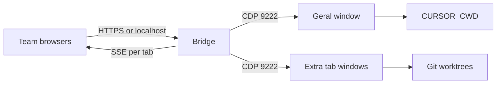

# Cursor Web Bridge

> A password-protected web room for a **Cursor Agent running on one host**. The team works from the browser. Each tab is its own Cursor window, so a long turn in one tab does not block the others.

The default backend drives the **Cursor IDE through CDP**. An optional `sdk` backend starts a parallel `@cursor/sdk` session instead. Point `CURSOR_CWD` at the repository you want; the bridge does not assume a specific project.

## What it is

A shared browser room in front of the Cursor Agent that is already open on the host.

In CDP mode the panel types into the Agent composer of a chosen window and mirrors the reply, the activity, and the approval cards. It is not a second copy of the IDE chat, and it does not sync with Cursor windows that are not opened as tabs.

What the room provides:

- Login with a **username and password**. An admin creates the accounts. There is no shared room password and no free-text display name at login.
- **Shared tabs.** Every signed-in user sees and can use every tab. The fixed tab, Geral, is the main workspace. Extra tabs are separate conversations.
- One real-time transcript per tab. Late joiners see that tab's history.
- One turn at a time **inside a tab**. Other tabs keep accepting prompts.
- Live typing in the composer of the active tab (last writer wins).
- Live audio and video on the Geral tab (WebRTC mesh).
- Agent activity (Exploring, tools, Planning) above the composer.
- Cursor **Allow** and **Ask questions** cards for that tab, so anyone in the room can decide.
- Downloads for `/tmp/...` paths the agent mentions in that tab.
- UI language follows the browser (`pt` or `en`; other locales fall back to English).

## Why it exists

The Cursor Agent is useful on one machine. Everyone else cannot see the transcript, send the next prompt, download a zip the agent left in `/tmp`, or answer an approval card without VNC, a call, or a screenshot.

This project opens that session to the people who need it, behind their own accounts, without each person installing the IDE or spending a separate API key.

## Where it helps

- **Several people, one host** — the machine with Cursor stays on; the team drives it from the panel.
- **Parallel work** — two tabs can run two turns at the same time, each in its own window and working copy.
- **Review and diagnosis** — product, support, and engineering watch the same investigation.
- **Onboarding** — someone follows the agent without installing Cursor.
- **Away from the host** — phone or another PC through a Cloudflare Tunnel or Ngrok.

## Advantages

| Approach | What you get | What you give up |
| --- | --- | --- |
| **This bridge (CDP)** | The IDE session and subscription; a web room; several tabs; presence; live audio on Geral; artifacts | Cursor must stay open with a debug port; UI selectors can change |
| `@cursor/sdk` / API only | A parallel session that does not touch the IDE | An API key; history separate from the IDE chat |
| Messenger-style CDP bridges | Control of the local IDE | A chat app, not a room with tabs, live audio, and downloads |

In short: **one host, several shared tabs, several people in the browser**.

## How it works



1. The host runs the bridge next to Cursor.
2. Cursor is started with `--remote-debugging-port=9222`.
3. Geral follows `CURSOR_CWD`. Its window title must contain that folder name as its own segment (`maiva - Cursor` matches `maiva`; it does not match `maiva-notes`).
4. `POST /api/chat` returns immediately with a message id. The turn runs in the background and publishes tokens on that tab's bus.
5. Each client listens on `GET /api/events?room=<id>` for the tab it is viewing. A lighter `GET /api/rooms/events` stream reports which other tabs are busy.

## Accounts

Accounts live in `data/users.json` on the host. That directory is gitignored. Passwords are stored as scrypt hashes. Roles are `admin` and `member`.

On the first boot, if `data/users.json` does not exist and both `BRIDGE_ADMIN_USER` and `BRIDGE_ADMIN_PASSWORD` are set, the bridge creates that admin. After that, the admin panel is the way to add and remove people. A member who calls an admin route gets HTTP 403. The admin cannot delete their own account or the last admin. Usernames are lowercase (`a-z`, `0-9`, `.`, `_`, `-`). Passwords need at least 8 characters.

`BRIDGE_PASSWORD` is still required for the process to start. It is **not** the login password.

The session cookie lasts 7 days. It is `HttpOnly` and `SameSite=Lax`, and `Secure` on HTTPS. It carries the user id, role, display name, and client id. Cookies from the old shared-password login are rejected; everyone signs in again.

## Shared tabs

Every signed-in user sees every tab. A tab is a conversation bound to one Cursor window.

- **Geral** (`id` `geral`) is permanent. Its folder is `CURSOR_CWD`. It cannot be removed. Live audio and video stay on this tab.
- **Extra tabs** are created by an admin. The bridge adds a git worktree beside the main checkout, on a branch `ws/<slug>`, from the current `HEAD` of Geral. The slug is `[a-z0-9-]`.
- Each extra tab gets its own `node_modules` via `npm ci`, so an install in one tab does not change the others. If disk is tight, the admin can create the tab with shared dependencies: `node_modules` is a symlink to Geral's, and the panel says so.
- Creating a tab answers HTTP 202 and finishes in the background, because `npm ci` can take longer than a proxy timeout. The tab shows `creating`, then `ready` or `error`. A restart in the middle marks it `error` / `interrupted`.
- The bridge opens the folder in the Cursor process that is already running. On startup, and before a turn, it reopens a window that disappeared from CDP. The panel says it is opening the window while that happens. If `ROOM_IDLE_CLOSE_MIN` is greater than 0, an extra tab with no turn and no pending decision for that many minutes has its window closed. Geral stays open. The next message opens the window again.
- Removing a tab closes that window. If the worktree has uncommitted changes, the admin must confirm. The worktree, its branch, and that tab's history can then be deleted. Geral cannot be removed.

### Resource check

Before a tab is created, the bridge reads available memory, free swap, and free disk.

- **Warn** when memory left after the estimated cost would be under 1 GB, or disk left after the cost would be under 3 GB. The panel shows the numbers and asks for confirmation.
- **Block** when memory left would be under 300 MB, disk cannot cover the cost plus 1 GB, or `MAX_WORKSPACES` is already reached. Confirmation does not override a block.

Defaults assume about 2000 MB of RAM and 4000 MB of disk per tab with its own `node_modules` (600 MB when dependencies are shared). Set `WORKSPACE_EST_*` from a measurement on the host. `MAX_WORKSPACES=0` means no count limit.

## Quick start (local)

Prerequisites: **Node.js 20+**, Cursor, [`cloudflared`](https://developers.cloudflare.com/cloudflare-one/connections/connect-apps/install-and-setup/installation/) or [Ngrok](https://ngrok.com/), `git`, and `zip` on `PATH` (folders under `/tmp` that have no sibling zip). Extra tabs also need `npm` on the bridge process `PATH`.

```bash
git clone https://github.com/glira/cursor-web-bridge.git
cd cursor-web-bridge
cp .env.example .env
```

Edit `.env`:

- `BRIDGE_PASSWORD` — any long value; required to boot, not used to sign in
- `BRIDGE_SESSION_SECRET` — a long secret for the cookie
- `BRIDGE_ADMIN_USER` and `BRIDGE_ADMIN_PASSWORD` — first admin, used only when `data/users.json` does not exist yet
- `CURSOR_CWD` — absolute path of the Geral workspace
- `CURSOR_CDP_TARGET` — folder name that appears in that window's title

```bash
npm install
npm run dev
# or: ./start-local.sh   (bridge + tunnel; see Remote team below)
```

Open `http://127.0.0.1:8787`, sign in with the admin username and password, and send a test prompt on Geral.

### Attach Cursor (CDP mode, default)

The debug port applies to the first process. Quit Cursor fully, then start it again:

```bash
# Linux (adjust the binary for your install)
cursor --no-sandbox \
  --disable-gpu \
  --disable-dev-shm-usage \
  --disable-backgrounding-occluded-windows \
  --disable-renderer-backgrounding \
  --remote-debugging-port=9222 \
  --remote-debugging-address=127.0.0.1 \
  --remote-allow-origins=* \
  /absolute/path/to/your-project
```

The two `backgrounding` flags matter when more than one window is open: a covered window keeps running the agent.

Then:

1. Open an **Agent → New Chat** in that window.
2. Confirm CDP: `curl http://127.0.0.1:9222/json/version`
3. Confirm the bridge: `curl http://127.0.0.1:8787/api/health`

Health should show `ok: true`, `hasChatInput: true`, and a `targetTitle` that matches `CURSOR_CDP_TARGET`. It also lists each tab and whether its window is open. If the expected window is missing, health fails on purpose.

Extra windows must be opened by the **same** Cursor process. Set `CURSOR_BIN`, `CURSOR_USER_DATA_DIR`, `CURSOR_DISPLAY`, and `CURSOR_RUNTIME_DIR` to the values that process already uses. A second launch with another runtime directory talks to a different socket and never shows up on port 9222.

### Remote team (Cloudflare Tunnel — fixed URL)

Recommended for a stable hostname (example: `https://bridge.example.com`). A Worker custom domain cannot reach localhost. Use **Tunnel + Access**.

**One-time setup (operator):**

1. Confirm zone `example.com` is **Active** in the Cloudflare account you will use for `cloudflared login`.
2. Install `cloudflared`, then: `cloudflared tunnel login` and `cloudflared tunnel create cursor-web-bridge`.
3. DNS: CNAME `bridge` → `<tunnel-id>.cfargotunnel.com` (**Proxied**). Do **not** attach a Worker Domain to the same hostname.
4. Ingress in `~/.cloudflared/config.yml` (or the file pointed by `CLOUDFLARE_CONFIG`):

```yaml
tunnel: <tunnel-id>
credentials-file: /home/YOU/.cloudflared/<tunnel-id>.json

ingress:
  - hostname: bridge.example.com
    service: http://127.0.0.1:8787
  - service: http_status:404
```

5. Zero Trust → Access → Application on `bridge.example.com` with an Allow policy for team emails. Account login stays as the next step. Access does not replace it.

**Run:**

```bash
# .env
TUNNEL_PROVIDER=cloudflare
CLOUDFLARE_TUNNEL_NAME=cursor-web-bridge
# remotely-managed tunnel (no cert.pem): CLOUDFLARE_TOKEN_FILE=~/.cloudflared/cursor-web-bridge.token
# or: CLOUDFLARE_CONFIG=/path/to/config.yml
BRIDGE_PUBLIC_URL=https://bridge.example.com

./start-local.sh
```

1. Share **`BRIDGE_PUBLIC_URL`**. Each person signs in with the username and password the admin created.
2. The host must stay on. The agent runs there.
3. When the session ends, stop the script (that stops `cloudflared`) and revoke Access policies if you need to.

HTTPS from Cloudflare enables camera and mic. Difficult NATs may still need TURN (`RTC_TURN_*`).

Bind the bridge to `127.0.0.1` (`BIND_HOST`) when a tunnel is the only public path. Do not publish the bridge port on the host firewall.

### Remote team (Ngrok — ad-hoc)

Ephemeral URL, for a one-off session:

```bash
TUNNEL_PROVIDER=ngrok ./start-local.sh
# or: ngrok http 8787
```

Share the `https://….ngrok-free.app` URL. Each person signs in with their own account. The host stays on. HTTPS is required off localhost for camera and mic.

## Using the room

1. Sign in with username and password.
2. The tab bar lists every tab and marks the ones that are busy.
3. The panel opens `EventSource` on `/api/events?room=` and receives that tab's snapshot, tokens, drafts, artifacts, and decisions. Presence and WebRTC signaling are global; the live panel is shown on Geral.
4. `POST /api/chat` with `room` runs the turn on that tab only. A second send to a busy tab returns HTTP 409 with the name of the person driving it.
5. `POST /api/draft` mirrors typed text on that tab (ephemeral).
6. `POST /api/decision` with `room` clicks Allow / the chosen question option in that tab's window only.

The admin button opens a dialog to create and delete users and tabs, and to read the current memory, swap, and disk. A warn requires confirmation. A block stops the create.

### Live typing

Whoever is typing broadcasts the draft (~120 ms) on the active tab. If you have focus in the box, the remote draft does not overwrite it; you see a “Someone is typing…” pill.

### Live audio and video

On Geral, open **Live**: join, allow mic and camera, mute, leave. Signaling stays in the room; media is peer-to-peer. Best up to about 6 people. A difficult NAT needs TURN (`RTC_TURN_*`).

### Message metadata

- User: `Name · 23:04`
- Assistant running: `Agent · by Ana · started 23:04 · running… · 42s`
- Assistant done: `Agent · by Ana · 23:04 → 23:09 · 5m 12s · finished`

### Full capture (CDP)

The bridge does not end the turn just because the first bubble stabilized. While the agent is working, the soft deadline (`CDP_TIMEOUT_MS`) extends up to `CDP_MAX_TIMEOUT_MS` (45 minutes). After the Stop control was seen, idle grace is 90 seconds; otherwise it is 25 seconds. Activity resets the idle timer. If the cap is hit while the agent is still active, the panel marks `timeout` and keeps the partial text.

A frozen window does not end the turn at the first 15 second CDP timeout. The bridge keeps the partial text and tries again. If the debug socket closes, it reopens that tab's window and reconnects. After `CDP_STALL_MAX_MS` (3 minutes) without a successful read, the turn ends as `timeout` with whatever text already arrived.

## `/tmp` downloads

When the agent prints a path such as `/tmp/report.zip` or `file:///tmp/folder/`, the bridge records it on **that tab**, attaches it to the message, and shows a download button. Only paths mentioned in that tab's session can be downloaded. A symlink that escapes `/tmp` is blocked.

## Environment variables

| Var | Description |
| --- | --- |
| `PORT` | HTTP port (default `8787`) |
| `BIND_HOST` | Bind address. Use `127.0.0.1` behind a tunnel |
| `BRIDGE_PASSWORD` | Required to start. Not the login password |
| `BRIDGE_SESSION_SECRET` | Session cookie secret |
| `BRIDGE_ADMIN_USER` | Username of the first admin, if `data/users.json` is missing |
| `BRIDGE_ADMIN_PASSWORD` | Password of that first admin (at least 8 characters) |
| `BRIDGE_BACKEND` | `cdp` (default) or `sdk` |
| `CURSOR_CDP_URL` | CDP HTTP URL (default `http://127.0.0.1:9222`) |
| `CURSOR_CDP_TARGET` | Folder name in the Geral window title |
| `CURSOR_API_KEY` | API key (`sdk` mode only) |
| `CURSOR_CWD` | Absolute path of the Geral workspace |
| `CURSOR_MODEL` | SDK model (default `composer-2.5`) |
| `WORKSPACES_BASE` | Parent directory for extra worktrees (default: parent of `CURSOR_CWD`) |
| `WORKSPACE_EST_RAM_MB` | Assumed RAM cost of a new tab (default `2000`) |
| `WORKSPACE_EST_DISK_MB` | Assumed disk cost with its own `node_modules` (default `4000`) |
| `WORKSPACE_EST_DISK_SHARED_MB` | Assumed disk cost with a shared `node_modules` (default `600`) |
| `MAX_WORKSPACES` | Cap on extra tabs. `0` means no cap |
| `CURSOR_BIN` | Cursor executable used to open another window |
| `CURSOR_USER_DATA_DIR` | Same user-data dir as the running Cursor |
| `CURSOR_DISPLAY` | X display for a headless host (default `:99`) |
| `CURSOR_RUNTIME_DIR` | Same `XDG_RUNTIME_DIR` as the running Cursor, so the new window joins its CDP |
| `CDP_POLL_MS` | DOM poll interval (default `400`) |
| `CDP_TIMEOUT_MS` | Soft window while the agent works (default `600000`) |
| `CDP_MAX_TIMEOUT_MS` | Absolute cap for one CDP turn (default `2700000`, 45 min) |
| `CDP_STALL_MAX_MS` | How long a frozen window can stall one turn before it stops as `timeout` (default `180000`) |
| `ROOM_IDLE_CLOSE_MIN` | Close extra-tab windows after this many idle minutes. `0` keeps them open |
| `RTC_STUN_URLS` | STUN for WebRTC |
| `RTC_TURN_URLS` / `RTC_TURN_USER` / `RTC_TURN_PASS` | Optional TURN |
| `TUNNEL_PROVIDER` | `ngrok` or `cloudflare`, used by `./start-local.sh` |
| `CLOUDFLARED_BIN` | Optional path or name for `cloudflared` |
| `CLOUDFLARE_TUNNEL_NAME` | Tunnel name for `cloudflared tunnel run` (needs `cert.pem`) |
| `CLOUDFLARE_TOKEN_FILE` | Token file for a remotely managed tunnel |
| `CLOUDFLARE_CONFIG` | Optional path to `config.yml` |
| `BRIDGE_PUBLIC_URL` | Fixed public URL printed by `./start-local.sh` |
| `NGROK_BIN` | Optional path or name for `ngrok` |

## Scripts

```bash
npm run dev        # watch (needs free inotify instances)
npm start          # no watch — what ./start-local.sh uses
npm run typecheck  # tsc --noEmit
./start-local.sh   # bridge + cloudflared or ngrok (TUNNEL_PROVIDER)
```

## Security

- Anyone with an account can send prompts on every tab, including worktrees the admin created. Treat an account as access to those checkouts.
- Prefer Cloudflare Access in front of the tunnel so only team emails reach the login page.
- Login has a simple per-IP rate limit.
- Do not commit `.env`, `data/users.json`, or `data/rooms/`. Do not log passwords or `CURSOR_API_KEY`.
- Details in [SECURITY.md](SECURITY.md).

## Limitations

- CDP mode drives the Agent chat that is visible in that window. Keep a dedicated chat open there.
- Cursor UI selectors can break on an IDE update.
- Images and attachments from the panel work better in `sdk` mode.
- A tab runs one turn at a time. Tabs do not block each other.
- Extra tabs need disk for a worktree and, unless dependencies are shared, a full `node_modules`.
- Live audio and video are a P2P mesh on Geral (best up to about 6 people). Without TURN, some NATs fail.
- Cookies issued before account login no longer work.

## License

[MIT](LICENSE)
